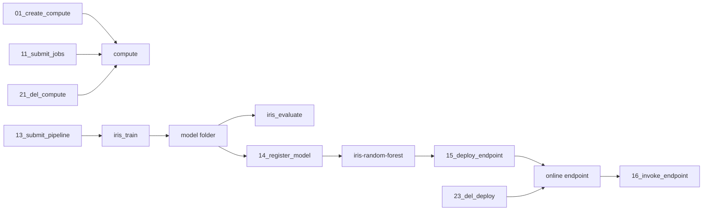

# Azure ML Pipeline

This project submits an Azure ML training pipeline from Python.
It registers the trained model and deploys that model to an online endpoint.

1. Create a compute cluster.
2. Submit one training job.
3. Submit a pipeline that trains a model and evaluates the model.
4. Register the trained model.
5. Deploy the model to an online endpoint.
6. Invoke the online endpoint.
7. Delete the online endpoint and the compute cluster.

## Prerequisites

- Python 3.10 or later
  `.github/workflows/python-ci.yml` at the repository root checks Python syntax in this directory.
  It uses Python 3.10.
  It runs when files in `mlops-pipeline` change.
  It compiles the files and does not install packages, run the scripts, or call Azure.
- An [Azure Machine Learning](https://learn.microsoft.com/azure/machine-learning/) workspace
- Permission to create a compute cluster and submit a job in that workspace
- Permission to create, invoke, and delete a managed online endpoint in that workspace
- Quota for one `Standard_D4as_v4` instance (8 DASv4 cores)
- An Azure CLI login for `DefaultAzureCredential`

The scripts use `DefaultAzureCredential`.
Run `az login` before you run the scripts.
Use an account that can access the workspace.

## Installation

Go to the `mlops-pipeline` directory.
Create a virtual environment.
Activate the virtual environment.
Install the required packages.

```bash
cd mlops-pipeline
python3 -m venv .venv
source .venv/bin/activate   # Windows: .venv\Scripts\activate
pip install -r requirements.txt
```

The prompt shows `(.venv)` after activation.
Then `python` and `pip` use that environment.

Leave the virtual environment with this command:

```bash
deactivate
```

In a new terminal, go to `mlops-pipeline` again.
Activate the virtual environment before you run a script.

Run each script from `mlops-pipeline`.
Do not set `PYTHONPATH`.

`requirements.txt` installs the packages that submit a job.
It also installs MLflow and scikit-learn.
`train.py` and `evaluate.py` run on the compute cluster.
The local virtual environment does not supply those packages to the job.
The compute environment supplies scikit-learn and MLflow.
The environment name is `sklearn-1.5`, version 53.

## Configuration

Copy the example file to `.env`.
Set your subscription, resource group, and workspace in `.env`.

```bash
cp .env.example .env
```

Do not commit `.env`.
`.gitignore` already lists `.env`.

Set every variable in the tables.
Each script reads only the variables it uses.
A script stops when one of those variables is missing.
The error message names that variable.

### Workspace variables

Use the subscription GUID.
Do not use the subscription display name.

| Variable                 | Description            |
| ------------------------ | ---------------------- |
| `AZURE_SUBSCRIPTION_ID`  | Subscription GUID      |
| `AZURE_RESOURCE_GROUP`   | Resource group name    |
| `AZURE_WORKSPACE_NAME`   | Workspace name         |

### Compute and job variables

`.env.example` gives an example for each variable.
Keep the example value.
Set a different value when the example does not fit your workspace.

| Variable                    | Example                                                                      | Description                          |
| --------------------------- | ---------------------------------------------------------------------------- | ------------------------------------ |
| `AZURE_COMPUTE_NAME`        | `cpu-cluster`                                                                | Compute name                         |
| `AZURE_COMPUTE_SIZE`        | `Standard_DS11_v2`                                                           | Compute size                         |
| `AZURE_COMPUTE_MIN_INSTANCES` | `0`                                                                        | Minimum node count                   |
| `AZURE_COMPUTE_MAX_INSTANCES` | `1`                                                                        | Maximum node count                   |
| `AZURE_COMPUTE_IDLE_SECONDS`  | `120`                                                                      | Idle seconds before scale-down       |
| `AZURE_ML_ENVIRONMENT`      | `azureml://registries/azureml/environments/sklearn-1.5/versions/53`         | Curated environment for the job      |
| `AZURE_EXPERIMENT_NAME`     | `sdk-v2-training`                                                            | Experiment name                      |
| `AZURE_JOB_DISPLAY_NAME`    | `sdk-v2-mlflow-artifact-test`                                                | Display name for the single job      |

`01_create_compute.py`, `11_submit_jobs.py`, `13_submit_pipeline.py`, and `21_del_compute.py` read `AZURE_COMPUTE_NAME`.
`01_create_compute.py` reads the compute size, the node counts, and the idle seconds.
`11_submit_jobs.py` and `13_submit_pipeline.py` read `AZURE_ML_ENVIRONMENT` and `AZURE_EXPERIMENT_NAME`.
`14_register_model.py` reads the three workspace variables.
`14_register_model.py` reads `AZURE_EXPERIMENT_NAME` when you omit `--train-job-name`.
`15_deploy_endpoint.py`, `16_invoke_endpoint.py`, and `23_del_deploy.py` read the three workspace variables.
Those three scripts do not read compute variables or job variables.
The endpoint name, the deployment name, and the VM size are set in those Python files.
`11_submit_jobs.py` is the only script that reads `AZURE_JOB_DISPLAY_NAME`.

## Usage

Run the commands from `mlops-pipeline`.
Activate the virtual environment first.

### 1. Create the compute cluster

This script creates an Azure ML compute cluster.

```bash
python 01_create_compute.py
```

The example compute name is `cpu-cluster`.
The example compute size is `Standard_DS11_v2`.
The example minimum node count is 0.
The example maximum node count is 1.
Azure ML scales the cluster down after 120 idle seconds.

### 2. Submit one training job

This script submits one command job.
The job uses `AZURE_JOB_DISPLAY_NAME`.
The job runs this command:

```text
python train.py --model_output ${{outputs.model_output}}
```

`train.py` requires `--model_output`.
The job writes a model folder.
The folder type is `uri_folder`.

```bash
python 11_submit_jobs.py
```

The script prints the job name.
The script prints the Studio URL.
The script waits until the job ends.

Open the job in Azure ML Studio.
Check the `accuracy` metric.
Check the model artifact.

### 3. Submit the pipeline

This script submits a pipeline with two steps.

```bash
python 13_submit_pipeline.py
```

The train component name is `iris_train`.
The train step display name is `train_step`.
The display name comes from the Python variable in the pipeline function.
`14_register_model.py` looks for `train_step`.
The script prints the pipeline job name.
That name is the parent job name.
The train step runs this command:

```text
python train.py --model_output ${{outputs.model_output}}
```

The train step writes a model folder.
The folder type is `uri_folder`.

The evaluate step name is `iris_evaluate`.
The evaluate step runs this command:

```text
python evaluate.py --model_input ${{inputs.model_input}}
```

The evaluate step reads the model folder from the train step.

The script prints the pipeline name.
The script prints the Studio URL.
The script waits until the pipeline ends.
The script prints the status of each step.

Open the train step in Azure ML Studio.
Check the `accuracy` metric.
Check the model artifact.
Open the evaluate step in Azure ML Studio.
Check the `eval_accuracy` metric.

The training code uses the Iris data set.
The model is a `RandomForestClassifier`.
The train step logs `n_estimators` in MLflow.
The train step logs the `accuracy` metric in MLflow.
The evaluate step logs the `eval_accuracy` metric in MLflow.

The code saves the model with `mlflow.sklearn.save_model`.
The code logs that model artifact with `mlflow.log_artifacts`.
The code does not call `mlflow.sklearn.log_model`.
Azure ML tracking does not support that API.

### 4. Register the model

Run this script after the pipeline ends.

```bash
python 14_register_model.py
```

The script reads `AZURE_EXPERIMENT_NAME`.
The script selects the latest completed pipeline in that experiment.
The script selects the completed step whose display name is `train_step`.

Pass a training step job name when you do not want the latest step.

```bash
python 14_register_model.py --train-job-name <train-step-job-name>
```

The script downloads the `model_output` folder to `downloaded_model/`.
`.gitignore` already lists `downloaded_model/`.
The script finds the folder that contains `MLmodel`.
The script adds `azureml-ai-monitoring` to `conda.yaml` in that folder.
The script adds `azureml-inference-server-http` to `conda.yaml` in that folder.
The script adds the same two packages to `requirements.txt` in that folder.
The online scoring script imports `azureml.ai.monitoring`.
The training output does not include that package.
The script registers that folder.
The model name is `iris-random-forest`.
The script prints the model name and the model version.
The same model name creates a new version.

### 5. Deploy the model

Run this script after the model is registered.

```bash
python 15_deploy_endpoint.py
```

The script gets the `latest` version of `iris-random-forest`.
The endpoint name is `iris-thomas-20261024`.
The authentication mode is `key`.
The deployment name is `blue`.
The VM size is `Standard_D4as_v4`.
The instance count is 1.
`Dsv6`, `Dsv7`, and `DSv4` are not online-endpoint SKUs.
`DSv2` is end of life.
`Standard_D4as_v4` is a supported online-endpoint SKU.
This size needs 8 DASv4 cores.
The script creates the endpoint.
The script creates the deployment.
Azure provisions a VM and prepares the model environment.
This step takes several minutes.
The script routes 100% of endpoint traffic to `blue`.
The script prints the endpoint name, the deployment name, and the provisioning state.
The training compute cluster is not used for this deployment.

Use the same endpoint name in `15_deploy_endpoint.py`, `16_invoke_endpoint.py`, and `23_del_deploy.py`.
Change that name in all three files together.

### 6. Invoke the endpoint

Run this script after the deployment is ready.

```bash
python 16_invoke_endpoint.py
```

The script sends one Iris sample to the `blue` deployment.
The values are sepal length, sepal width, petal length, and petal width.

```text
[5.1, 3.5, 1.4, 0.2]
```

The script writes that request to a temporary JSON file.
The script prints the response.

## Project layout

```text
mlops-pipeline/
  .env.example
  README.md
  requirements.txt
  azure_config.py            # Loads .env and creates the Azure ML client
  01_create_compute.py       # Creates the compute cluster
  11_submit_jobs.py          # Submits one training job
  13_submit_pipeline.py      # Submits the train step and the evaluate step
  14_register_model.py       # Registers the model from the train step
  15_deploy_endpoint.py      # Deploys the model to an online endpoint
  16_invoke_endpoint.py      # Sends one sample to the online endpoint
  21_del_compute.py          # Deletes the compute cluster
  23_del_deploy.py           # Deletes the online endpoint
  src/
    train.py                 # Trains the Iris model
    evaluate.py              # Evaluates the saved model
```

## Pipeline overview



## Cleanup

Delete the online endpoint when you finish the test.
The endpoint is billed separately from the compute cluster.

```bash
python 23_del_deploy.py
```

The script deletes the endpoint and its deployments.

Delete the compute cluster when you finish the work.

```bash
python 21_del_compute.py
```

The example minimum node count is 0.
A minimum node count of 0 lets Azure ML scale the cluster to zero.
Check Azure Cost Management after you delete the compute cluster.

## Troubleshooting

**Missing environment variable**

The error names the missing variable.
Copy `.env.example` to `.env`.
Set the missing variable.

**Azure login failed**

Run `az login`.
Use an account that can access the workspace.
Confirm the subscription, resource group, and workspace name in `.env`.

