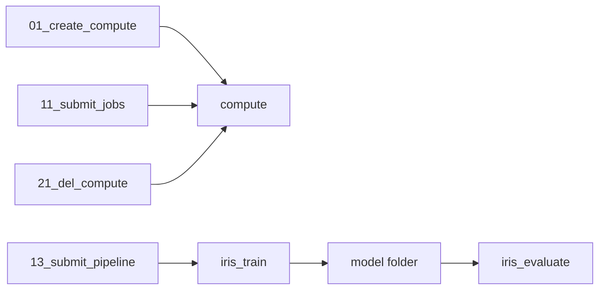

# Azure ML Pipeline

This project submits an Azure ML training pipeline from Python.

1. Create a compute cluster.
2. Submit one training job.
3. Submit a pipeline that trains a model and evaluates the model.
4. Delete the compute cluster.

## Prerequisites

- Python 3.10 or later
- An [Azure Machine Learning](https://learn.microsoft.com/azure/machine-learning/) workspace
- Permission to create a compute cluster and submit a job in that workspace
- An Azure CLI login for `DefaultAzureCredential`

The scripts use `DefaultAzureCredential`.
Run `az login` before you run the scripts.
Use an account that can access the workspace.

## Installation

Go to the `mlops-pipeline` directory.
Create a virtual environment.
Activate the virtual environment.
Install the required packages.

```bash
cd mlops-pipeline
python3 -m venv .venv
source .venv/bin/activate   # Windows: .venv\Scripts\activate
pip install -r requirements.txt
```

The prompt shows `(.venv)` after activation.
Then `python` and `pip` use that environment.

Leave the virtual environment with this command:

```bash
deactivate
```

In a new terminal, go to `mlops-pipeline` again.
Activate the virtual environment before you run a script.

Run each script from `mlops-pipeline`.
Do not set `PYTHONPATH`.

`requirements.txt` installs the packages that submit a job.
It also installs MLflow and scikit-learn.
`train.py` and `evaluate.py` run on the compute cluster.
The local virtual environment does not supply those packages to the job.
The compute environment supplies scikit-learn and MLflow.
The environment name is `sklearn-1.5`, version 53.

## Configuration

Copy the example file to `.env`.
Set your subscription, resource group, and workspace in `.env`.

```bash
cp .env.example .env
```

Do not commit `.env`.
`.gitignore` already lists `.env`.

Set every variable in the tables.
Each script reads only the variables it uses.
A script stops when one of those variables is missing.
The error message names that variable.

### Workspace variables

Use the subscription GUID.
Do not use the subscription display name.

| Variable                 | Description            |
| ------------------------ | ---------------------- |
| `AZURE_SUBSCRIPTION_ID`  | Subscription GUID      |
| `AZURE_RESOURCE_GROUP`   | Resource group name    |
| `AZURE_WORKSPACE_NAME`   | Workspace name         |

### Compute and job variables

`.env.example` gives an example for each variable.
Keep the example value.
Set a different value when the example does not fit your workspace.

| Variable                    | Example                                                                      | Description                          |
| --------------------------- | ---------------------------------------------------------------------------- | ------------------------------------ |
| `AZURE_COMPUTE_NAME`        | `cpu-cluster`                                                                | Compute name                         |
| `AZURE_COMPUTE_SIZE`        | `Standard_DS11_v2`                                                           | Compute size                         |
| `AZURE_COMPUTE_MIN_INSTANCES` | `0`                                                                        | Minimum node count                   |
| `AZURE_COMPUTE_MAX_INSTANCES` | `1`                                                                        | Maximum node count                   |
| `AZURE_COMPUTE_IDLE_SECONDS`  | `120`                                                                      | Idle seconds before scale-down       |
| `AZURE_ML_ENVIRONMENT`      | `azureml://registries/azureml/environments/sklearn-1.5/versions/53`         | Curated environment for the job      |
| `AZURE_EXPERIMENT_NAME`     | `sdk-v2-training`                                                            | Experiment name                      |
| `AZURE_JOB_DISPLAY_NAME`    | `sdk-v2-mlflow-artifact-test`                                                | Display name for the single job      |

Every script reads the three workspace variables and `AZURE_COMPUTE_NAME`.
`01_create_compute.py` reads the compute size, the node counts, and the idle seconds.
`11_submit_jobs.py` and `13_submit_pipeline.py` read `AZURE_ML_ENVIRONMENT` and `AZURE_EXPERIMENT_NAME`.
`11_submit_jobs.py` is the only script that reads `AZURE_JOB_DISPLAY_NAME`.

## Usage

Run the commands from `mlops-pipeline`.
Activate the virtual environment first.

### 1. Create the compute cluster

This script creates an Azure ML compute cluster.

```bash
python 01_create_compute.py
```

The example compute name is `cpu-cluster`.
The example compute size is `Standard_DS11_v2`.
The example minimum node count is 0.
The example maximum node count is 1.
Azure ML scales the cluster down after 120 idle seconds.

### 2. Submit one training job

This script submits one command job.
The job uses `AZURE_JOB_DISPLAY_NAME`.
The job runs this command:

```text
python train.py --model_output ${{outputs.model_output}}
```

`train.py` requires `--model_output`.
The job writes a model folder.
The folder type is `uri_folder`.

```bash
python 11_submit_jobs.py
```

The script prints the job name.
The script prints the Studio URL.
The script waits until the job ends.

Open the job in Azure ML Studio.
Check the `accuracy` metric.
Check the model artifact.

### 3. Submit the pipeline

This script submits a pipeline with two steps.

```bash
python 13_submit_pipeline.py
```

The train step name is `iris_train`.
The train step runs this command:

```text
python train.py --model_output ${{outputs.model_output}}
```

The train step writes a model folder.
The folder type is `uri_folder`.

The evaluate step name is `iris_evaluate`.
The evaluate step runs this command:

```text
python evaluate.py --model_input ${{inputs.model_input}}
```

The evaluate step reads the model folder from the train step.

The script prints the pipeline name.
The script prints the Studio URL.
The script waits until the pipeline ends.
The script prints the status of each step.

Open the train step in Azure ML Studio.
Check the `accuracy` metric.
Check the model artifact.
Open the evaluate step in Azure ML Studio.
Check the `eval_accuracy` metric.

The training code uses the Iris data set.
The model is a `RandomForestClassifier`.
The train step logs `n_estimators` in MLflow.
The train step logs the `accuracy` metric in MLflow.
The evaluate step logs the `eval_accuracy` metric in MLflow.

The code saves the model with `mlflow.sklearn.save_model`.
The code logs that model artifact with `mlflow.log_artifacts`.
The code does not call `mlflow.sklearn.log_model`.
Azure ML tracking does not support that API.

## Project layout

```text
mlops-pipeline/
  .env.example
  README.md
  requirements.txt
  azure_config.py            # Loads .env and creates the Azure ML client
  01_create_compute.py       # Creates the compute cluster
  11_submit_jobs.py          # Submits one training job
  13_submit_pipeline.py      # Submits the train step and the evaluate step
  21_del_compute.py          # Deletes the compute cluster
  src/
    train.py                 # Trains the Iris model
    evaluate.py              # Evaluates the saved model
```

## Pipeline overview



## Cleanup

Delete the compute cluster when you finish the work.

```bash
python 21_del_compute.py
```

The example minimum node count is 0.
A minimum node count of 0 lets Azure ML scale the cluster to zero.
Check Azure Cost Management after you delete the compute cluster.

## Troubleshooting

**Missing environment variable**

The error names the missing variable.
Copy `.env.example` to `.env`.
Set the missing variable.

**Azure login failed**

Run `az login`.
Use an account that can access the workspace.
Confirm the subscription, resource group, and workspace name in `.env`.

